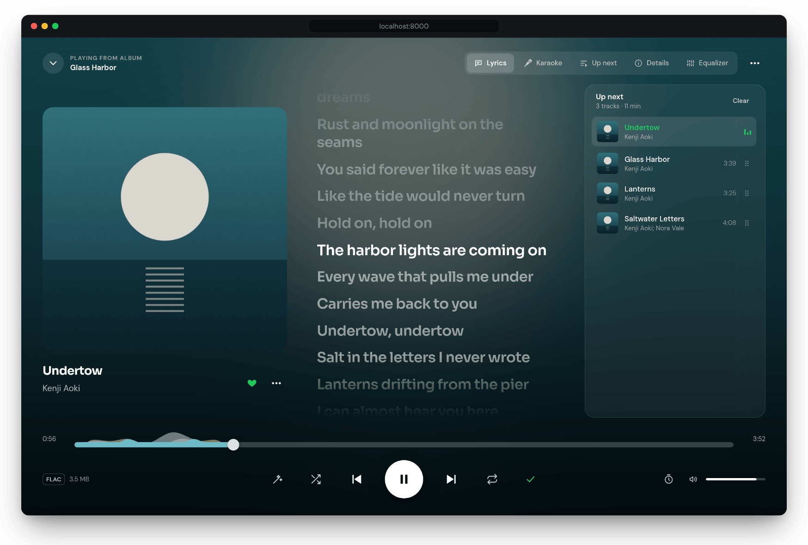
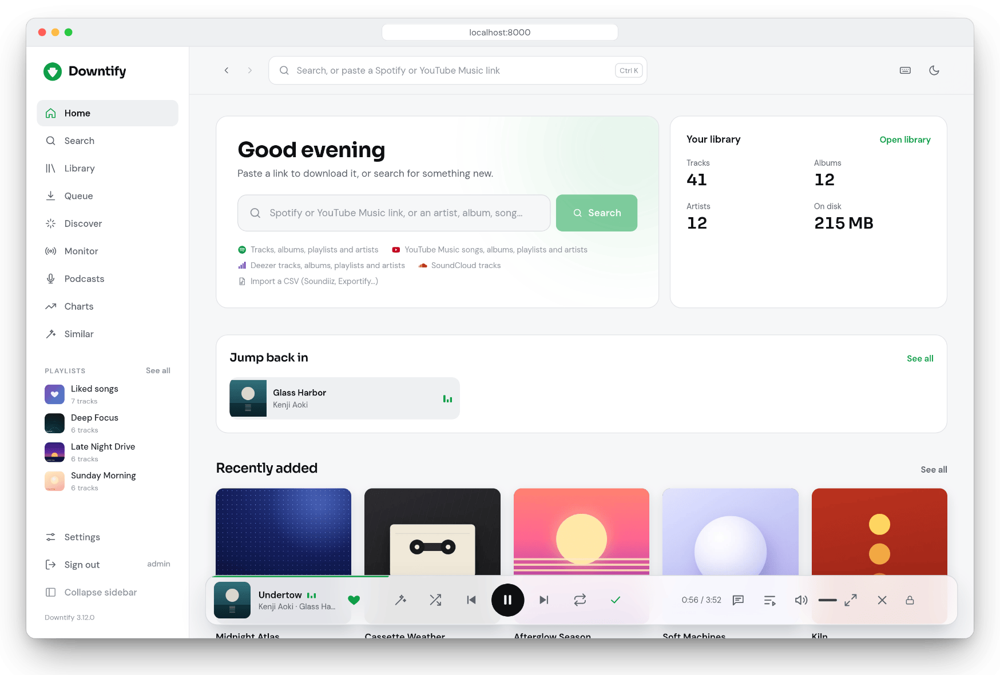
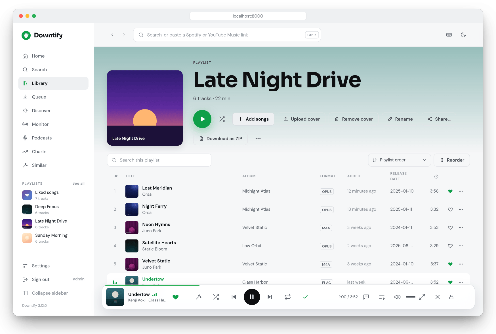
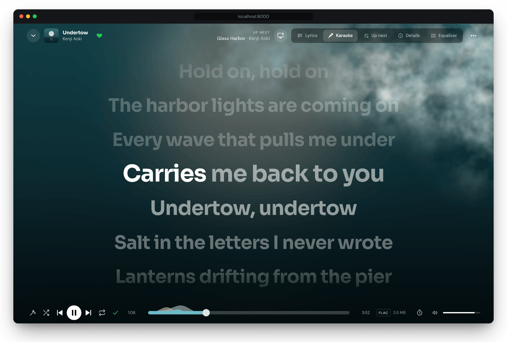
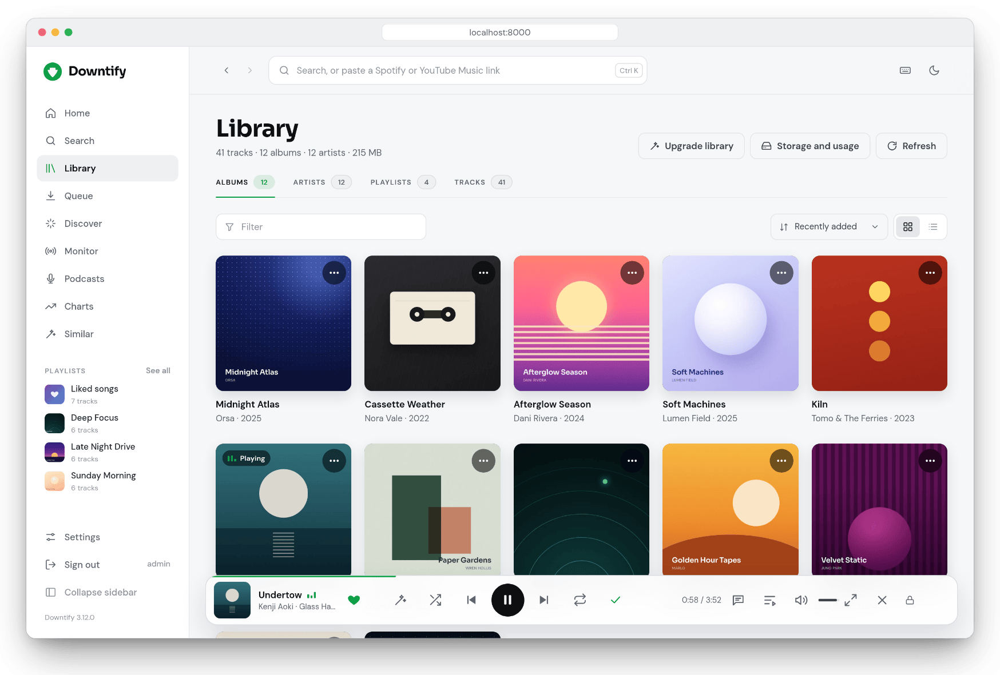
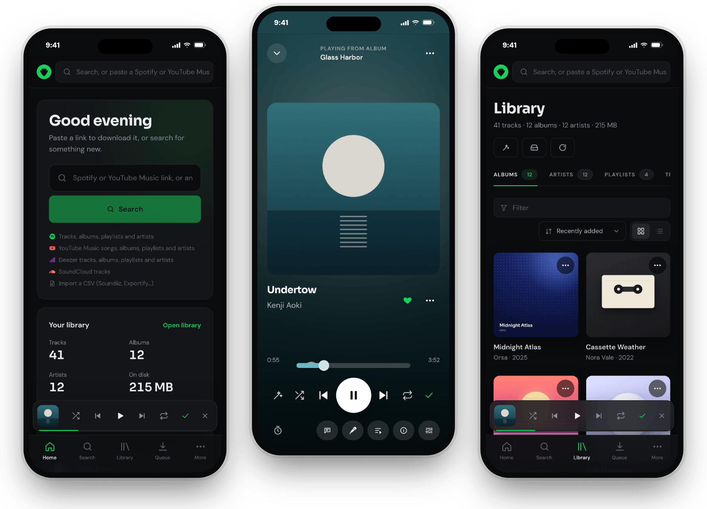
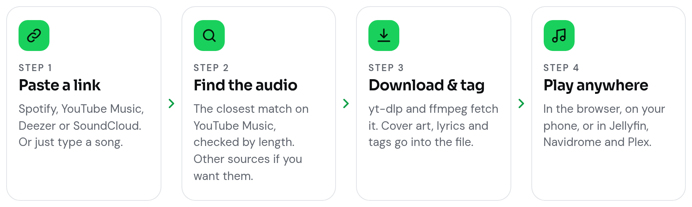

<p align="center">
  <picture>
    <source media="(prefers-color-scheme: dark)" srcset="assets/readme/wordmark-dark.png">
    <source media="(prefers-color-scheme: light)" srcset="assets/readme/wordmark-light.png">
    
  </picture>
</p>

<h3 align="center">Paste a link. Get the music.</h3>

<p align="center">
  A self-hosted music downloader with a player built in. Paste a Spotify, YouTube Music, Deezer or SoundCloud link and get a perfectly tagged library, ready to play in your browser, on your phone or in your media server.
  <br><b>No Spotify account, no API keys, no Premium.</b>
</p>

<p align="center">
  <a href="https://github.com/henriquesebastiao/downtify/releases"></a>
  <a href="https://github.com/henriquesebastiao/downtify/pkgs/container/downtify"></a>
  <a href="https://star-history.com/#henriquesebastiao/downtify&Date"></a>
  <a href="https://github.com/henriquesebastiao/downtify/actions/workflows/test.yml"></a>
  <a href="https://coverage-badge.samuelcolvin.workers.dev/redirect/henriquesebastiao/downtify"></a>
  <a href="LICENSE"></a>
</p>

<p align="center">
  <a href="#quick-start"><b>Quick start</b></a> ·
  <a href="#features">Features</a> ·
  <a href="https://downtify.henriquesebastiao.com/">Documentation</a> ·
  <a href="#mobile-apps">Mobile apps</a> ·
  <a href="https://downtify.henriquesebastiao.com/changelog/">Changelog</a> ·
  <a href="#support-downtify">Support</a>
</p>

https://github.com/user-attachments/assets/a70b6a0d-fa22-4aa4-b6ca-2491c864c6af

## Why Downtify

<table>
<tr>
<td width="50%" valign="top">

###  One link is all it takes

Paste a song, an album, a whole playlist or an artist from Spotify, YouTube Music, Deezer or SoundCloud, or just type what you want to hear. Downtify finds the audio and brings it home.

###  Files worth keeping

Every file carries its cover art, every credited artist, the album, year, track number and lyrics, time-synced when they exist. MP3, FLAC, M4A, OGG or Opus, or the source audio exactly as it came.

###  Your own streaming service

A full player in the browser, with synced lyrics, karaoke, a queue, liked songs, playlists and podcasts. Apps for Android and iOS take your library with you, offline too.

</td>
<td width="50%" valign="top">

###  Set it and forget it

Watch playlists and artists. New songs and new releases download on their own, on the schedule you choose.

###  Made for your home server

One Docker image for amd64 and arm64, SQLite or PostgreSQL, accounts for everyone at home with optional single sign-on, and playlists that Jellyfin, Navidrome and Plex pick up.

###  No strings attached

No Spotify API key, no developer account, no Premium. No ads, no analytics, nothing behind a paywall: Downtify is free and open source.

</td>
</tr>
</table>

## Quick start

All you need is [Docker](https://docs.docker.com/get-docker/):

```bash
docker run -d -p 8000:8000 --name downtify \
  -v /path/to/music:/downloads \
  -v downtify_data:/data \
  --restart unless-stopped \
  ghcr.io/henriquesebastiao/downtify
```

Open **[localhost:8000](http://localhost:8000)**, sign in as **`admin`** / **`downtify`** and paste a link. Then change that password in **Settings → General** (or turn accounts off with `DOWNTIFY_DISABLE_AUTH=true` on a server only you can reach).

Your music lands in `/path/to/music`; `/data` keeps the database and settings. Keep both on persistent storage.

<details>
<summary><b>Docker Compose</b></summary>
<br>

```yaml
services:
  downtify:
    container_name: downtify
    image: ghcr.io/henriquesebastiao/downtify:latest
    ports:
      - '8000:8000'
    volumes:
      - ./downloads:/downloads
      - downtify_data:/data
    restart: unless-stopped

volumes:
  downtify_data:
```

To stay on one release line instead of `latest`, pin a major, minor or exact version tag (`:3`, for example). For another port, PostgreSQL, a timezone or a cookies file, see [Docker Compose](https://downtify.henriquesebastiao.com/getting-started/docker-compose/) and [Environment variables](https://downtify.henriquesebastiao.com/getting-started/environment-variables/); everything else is set in **Settings**, inside the app.

</details>

**Prefer one click?** Downtify is in the app stores of [Umbrel](https://apps.umbrel.com/app/downtify), [CasaOS](https://casaos.zimaspace.com/) and [HomeDock OS](https://www.homedock.cloud/apps/downtify/).

## A closer look

<p align="center">
  
  <br>
  <sub><b>Now Playing.</b> Lyrics follow the song, line by line, next to the cover and what's up next.</sub>
</p>

<p align="center">
  <picture>
    <source media="(prefers-color-scheme: dark)" srcset="assets/readme/home-dark.png">
    <source media="(prefers-color-scheme: light)" srcset="assets/readme/home-light.png">
    
  </picture>
  <picture>
    <source media="(prefers-color-scheme: dark)" srcset="assets/readme/playlist-dark.png">
    <source media="(prefers-color-scheme: light)" srcset="assets/readme/playlist-light.png">
    
  </picture>
  <br>
  <sub><b>Home</b> picks up where you left off. <b>Playlists</b> get their own covers, and can be shared.</sub>
</p>

<p align="center">
  
  <picture>
    <source media="(prefers-color-scheme: dark)" srcset="assets/readme/library-dark.png">
    <source media="(prefers-color-scheme: light)" srcset="assets/readme/library-light.png">
    
  </picture>
  <br>
  <sub><b>Karaoke</b> fills each line as it is sung, and opens on a second screen. The <b>Library</b> sorts and filters it all.</sub>
</p>

<p align="center">
  
  <br>
  <sub><b>On your phone</b>, the same app installs from the browser. Or use the <a href="#mobile-apps">Android and iOS apps</a>.</sub>
</p>

## Features

|                 |                                                                                                                                                                                                                                                                                                                                                                                                                                                                                                                                                                                                                                                                                                                                                                                                                                                                                                                  |
| --------------- | -------------------------------------------------------------------------------------------------------------------------------------------------------------------------------------------------------------------------------------------------------------------------------------------------------------------------------------------------------------------------------------------------------------------------------------------------------------------------------------------------------------------------------------------------------------------------------------------------------------------------------------------------------------------------------------------------------------------------------------------------------------------------------------------------------------------------------------------------------------------------------------------------------------- |
| **Find**        | [Paste a link](#what-you-can-paste) or search by name · [Discover](https://downtify.henriquesebastiao.com/features/discover/) artists and albums you don't have yet · Deezer's [Charts](https://downtify.henriquesebastiao.com/features/charts/) · whole discographies in the [Finder](https://downtify.henriquesebastiao.com/features/finder/) · [Similar](https://downtify.henriquesebastiao.com/features/similar/) tracks · an artist's [top songs](https://downtify.henriquesebastiao.com/features/top-songs/) · [CSV imports](https://downtify.henriquesebastiao.com/features/library-import/) from Soundiiz, TuneMyMusic and Exportify · [where to buy](https://downtify.henriquesebastiao.com/features/support-artists/) what you love                                                                                                                                                                       |
| **Download**    | MP3, FLAC, M4A, OGG or Opus at the bitrate you pick, or the source audio untouched ([settings](https://downtify.henriquesebastiao.com/features/download-settings/)) · YouTube Music first, YouTube as fallback, and optional [SoundCloud](https://downtify.henriquesebastiao.com/features/soundcloud/), [Soulseek](https://downtify.henriquesebastiao.com/features/slskd-navidrome/) and [Deemix](https://downtify.henriquesebastiao.com/features/deemix/) sources · a [queue](https://downtify.henriquesebastiao.com/features/download-queue/) you can pause, that survives a restart                                                                                                                                                                                                                                                                                                                                   |
| **Tags**        | Cover art, every credited artist, album artist, year, track number and the [explicit mark](https://downtify.henriquesebastiao.com/features/explicit-marker/) · plain and time-synced [lyrics](https://downtify.henriquesebastiao.com/features/lyrics/) from LRCLIB, NetEase and Kugou, embedded and as `.lrc`, with their [timing adjustable](https://downtify.henriquesebastiao.com/features/lyrics/#adjusting-the-timing) from the player · each song's [music video](https://downtify.henriquesebastiao.com/features/music-videos/) saved beside it for Plex and Jellyfin and shown in the player (opt-in) · [Upgrade library](https://downtify.henriquesebastiao.com/features/library-upgrade/) repairs small covers, missing lyrics and incomplete tags in place · [Replace audio](https://downtify.henriquesebastiao.com/features/replace-audio/) when a song matched the wrong version · [Identify songs by sound](https://downtify.henriquesebastiao.com/features/acoustid/) (AcoustID, opt-in) adds ISRCs to older files                                                                                                                                                                                         |
| **Listen**      | A full-screen [player](https://downtify.henriquesebastiao.com/features/player/) with synced lyrics, karaoke, an editable queue, a sleep timer, keyboard shortcuts, media keys and an experimental ten-band equalizer · [volume normalization](https://downtify.henriquesebastiao.com/features/playback-normalization/) · [liked songs](https://downtify.henriquesebastiao.com/features/liked-songs/) · [podcasts](https://downtify.henriquesebastiao.com/features/podcasts/) by RSS feed, Spotify link or name · installs as an [app](https://downtify.henriquesebastiao.com/features/pwa/)                                                                                                                                                                                                                                                                                                                                  |
| **Automate**    | The [Playlist Monitor](https://downtify.henriquesebastiao.com/features/playlist-monitor/) keeps Spotify, Deezer and YouTube Music playlists and artists in sync on your schedule, suggests artists to follow, and shows what each watch adds and how much space it takes · [notifications](https://downtify.henriquesebastiao.com/features/notifications/) on Discord (with `/status` commands), ntfy, Gotify or a webhook |
| **Organize**    | Albums, artists, playlists and tracks in the [Library](https://downtify.henriquesebastiao.com/features/library-catalog/) · playlists of your own, in [any order](https://downtify.henriquesebastiao.com/features/playlist-order/) and with [their own cover](https://downtify.henriquesebastiao.com/features/playlist-cover-art/) · [hide songs](https://downtify.henriquesebastiao.com/features/hidden-playlist-songs/) from an imported playlist · a playlist saved as [one album](https://downtify.henriquesebastiao.com/features/file-organization/#downloading-a-playlist-as-an-album) · bring in [music folders](https://downtify.henriquesebastiao.com/features/external-library/) (watches link what they hold, so new downloads can [land in a separate folder](https://downtify.henriquesebastiao.com/features/external-library/#keep-new-downloads-apart-from-your-library)) and [M3U playlists](https://downtify.henriquesebastiao.com/features/external-playlists/) you already have · [artist photos](https://downtify.henriquesebastiao.com/features/artist-images/) · [storage & usage](https://downtify.henriquesebastiao.com/features/storage-usage/) · a [trash](https://downtify.henriquesebastiao.com/features/music-trash/) · [backups](https://downtify.henriquesebastiao.com/features/backups/) · a [Doctor](https://downtify.henriquesebastiao.com/features/doctor/) that cleans up after older versions |
| **Share**       | [Accounts](https://downtify.henriquesebastiao.com/features/users/) for everyone at home, with OpenID Connect sign-in · one shared library (or [one per user](https://downtify.henriquesebastiao.com/features/users/#a-library-for-each-user)), with songs, albums or artists an admin can hide · per-user [storage quotas](https://downtify.henriquesebastiao.com/features/storage-quotas/) · playlists shared view-only or [together](https://downtify.henriquesebastiao.com/features/collaborative-playlists/) · an activity log                                                                                                                                                                                                                                                                                                                                                                                                                                                                               |
| **Connect**     | [M3U playlists](https://downtify.henriquesebastiao.com/features/m3u-export/) that Jellyfin, Navidrome and Plex pick up · [Navidrome](https://downtify.henriquesebastiao.com/features/slskd-navidrome/) playlist sync and [ratings from Deezer](https://downtify.henriquesebastiao.com/features/navidrome-ratings/) · an [outbound proxy](https://downtify.henriquesebastiao.com/features/outbound-proxy/) · [PostgreSQL](https://downtify.henriquesebastiao.com/database/) · [13 languages](https://downtify.henriquesebastiao.com/features/internationalization/)                                                                                                                                                                                                                                                                                                                                                             |

Every feature has its own page, with every option explained, in the [documentation](https://downtify.henriquesebastiao.com/features/).

## How it works

<p align="center">
  <picture>
    <source media="(prefers-color-scheme: dark)" srcset="assets/readme/how-it-works-dark.png">
    <source media="(prefers-color-scheme: light)" srcset="assets/readme/how-it-works-light.png">
    
  </picture>
</p>

Downtify needs no Spotify API key and never downloads from Spotify. It reads what a link points to from public sources, picks the YouTube Music audio whose length matches best, downloads it with [yt-dlp](https://github.com/yt-dlp/yt-dlp), converts it with ffmpeg and tags it with [mutagen](https://mutagen.readthedocs.io/), all in one container. YouTube steps in when nothing matches well, and SoundCloud, Soulseek and Deemix join in if you turn them on. **[The whole pipeline, step by step →](https://downtify.henriquesebastiao.com/how-it-works/)**

## What you can paste

| Source        | What works                         | Example                             |
| ------------- | ---------------------------------- | ----------------------------------- |
| Spotify       | Tracks, albums, playlists, artists | `open.spotify.com/playlist/…`       |
| YouTube Music | Songs, albums, playlists, artists  | `music.youtube.com/playlist?list=…` |
| YouTube       | Videos                             | `youtube.com/watch?v=…`             |
| Deezer        | Tracks, albums, playlists, artists | `deezer.com/album/…`                |
| SoundCloud    | Tracks                             | `soundcloud.com/artist/track`       |
| Search        | Whatever you would type            | `The Night Owls Do I Still Recall`  |
| CSV           | Library exports                    | Soundiiz, TuneMyMusic, Exportify    |

An artist link opens the artist's page, with their releases and their most popular songs ([Top songs](https://downtify.henriquesebastiao.com/features/top-songs/)).

## FAQ

<details>
<summary><b>Do I need a Spotify account, Premium or an API key?</b></summary>
<br>

No. Downtify reads track, album and playlist details from Spotify's public embed pages, so it needs no credentials of any kind, and the audio never comes from Spotify. See [How it works](https://downtify.henriquesebastiao.com/how-it-works/).

</details>

<details>
<summary><b>Where does the audio come from, and how good is it?</b></summary>
<br>

From YouTube Music by default: the result whose length matches the song best, with YouTube as a fallback. Pick MP3, FLAC, M4A, OGG or Opus at the bitrate you want, or keep the best audio the source has without re-encoding it. Lossless files come from sources you add yourself: your own [Soulseek (slskd)](https://downtify.henriquesebastiao.com/features/slskd-navidrome/) server, whose files are kept in their original format, or a [Deemix](https://downtify.henriquesebastiao.com/features/deemix/) server. See [Download settings](https://downtify.henriquesebastiao.com/features/download-settings/).

</details>

<details>
<summary><b>Does it work with Jellyfin, Navidrome or Plex?</b></summary>
<br>

Yes. Files are tagged the way media servers expect, filed in `Artist/Album/` folders, and every playlist gets a standard M3U file they pick up. Navidrome can also get its playlists synced and ratings set from Deezer. See [File organization](https://downtify.henriquesebastiao.com/features/file-organization/) and [M3U export](https://downtify.henriquesebastiao.com/features/m3u-export/).

</details>

<details>
<summary><b>Will it run on a Raspberry Pi or a NAS?</b></summary>
<br>

The image is built for both `amd64` and `arm64`, and Umbrel, CasaOS and HomeDock OS install it in one click. See [Installation](https://downtify.henriquesebastiao.com/getting-started/installation/).

</details>

<details>
<summary><b>YouTube says "Sign in to confirm you're not a bot". What now?</b></summary>
<br>

Upload a `cookies.txt` in **Settings → YouTube cookies**; Downtify then keeps that session signed in on its own. If YouTube still rate-limits you, raise _Pause between downloads_, lower _Parallel downloads_, then try `DOWNTIFY_FORCE_IPV4=1`. See [Troubleshooting](https://downtify.henriquesebastiao.com/troubleshooting/) and [YouTube cookies](https://downtify.henriquesebastiao.com/features/youtube-cookies/).

</details>

## Mobile apps

<a href="https://github.com/henriquesebastiao/downtify-android"></a>

**[Downtify for Android](https://github.com/henriquesebastiao/downtify-android)** is the official app. It finds your server on the home network, signs in with your account (or pairs with a QR code from **Settings → Apps**), and streams your library in its original quality on Wi-Fi and a smaller one on mobile data, with songs kept on the phone for offline listening and Android Auto support. It is young and still in testing: get it from [GitHub Releases](https://github.com/henriquesebastiao/downtify-android/releases) or [Obtainium](https://github.com/henriquesebastiao/downtify-android#download).

**[Downtify for iOS](https://github.com/michaelmoskie/Downtify-IOS-Client)**, built by community member [michaelmoskie](https://github.com/michaelmoskie), brings the library, offline songs and lock-screen controls to iPhone and iPad (iOS 17 or later). The public beta is on [TestFlight](https://testflight.apple.com/join/Uej1Yta5).

Want to build your own client? Everything goes through the same API: see the [mobile client contract](https://downtify.henriquesebastiao.com/mobile-client-contract/).

## Documentation

|                                                                                    |                                                                     |
| ---------------------------------------------------------------------------------- | ------------------------------------------------------------------- |
| [Getting started](https://downtify.henriquesebastiao.com/getting-started/)         | Installation, Docker Compose, one-click installs and every variable |
| [Features](https://downtify.henriquesebastiao.com/features/)                       | One page per feature, with every option explained                   |
| [How it works](https://downtify.henriquesebastiao.com/how-it-works/)               | The metadata, matching and tagging pipeline                         |
| [Troubleshooting](https://downtify.henriquesebastiao.com/troubleshooting/)         | Symptoms, causes and fixes                                          |
| [API reference](https://downtify.henriquesebastiao.com/api-reference/)             | Every endpoint the web app and the mobile apps use                  |
| [Changelog](https://downtify.henriquesebastiao.com/changelog/)                     | What changed in each release                                        |

The app speaks English, Spanish, Brazilian Portuguese, French, German, Greek, Turkish, Hungarian, Bulgarian, Korean, Russian, and Simplified and Traditional Chinese; the documentation, nearly all of them.

## Community

Downtify grows in the open. More than 35 people have contributed code, community translators brought the app to 13 languages, and many features began as an idea someone opened as an issue.

- **Questions and ideas**: start a [discussion](https://github.com/henriquesebastiao/downtify/discussions).
- **Found a bug?** [Open an issue](https://github.com/henriquesebastiao/downtify/issues/new/choose); its templates ask for what helps most.
- **Speak another language?** [Translate the app or the docs](https://downtify.henriquesebastiao.com/features/internationalization/); a partial translation is welcome.
- **Want to write code?** Read [CONTRIBUTING.md](CONTRIBUTING.md) for the setup, the standards and the pull request checklist.

<a href="https://github.com/henriquesebastiao/downtify/graphs/contributors"></a>

## Support Downtify

Downtify is free, with no ads and no paid tier, and is maintained by [Henrique Sebastião](https://github.com/henriquesebastiao) with help from the community. If it has earned a place on your server, there are a few ways to give back:

- **Star the repository.** It helps other people find Downtify.
- **Tell someone about it**: a friend who self-hosts, your homelab forum, a blog post.
- **Sponsor its development** on [GitHub Sponsors](https://github.com/sponsors/henriquesebastiao) or [Buy Me a Coffee](https://www.buymeacoffee.com/henriquesebastiao). It helps pay for the time that goes into every release.

<a href="https://star-history.com/#henriquesebastiao/downtify&Date">
  <picture>
    <source media="(prefers-color-scheme: dark)" srcset="https://api.star-history.com/svg?repos=henriquesebastiao/downtify&type=Date&theme=dark">
    <source media="(prefers-color-scheme: light)" srcset="https://api.star-history.com/svg?repos=henriquesebastiao/downtify&type=Date">
    
  </picture>
</a>

## License

Downtify is free software, licensed under the [AGPL-3.0](LICENSE).

> [!WARNING]
> Users are responsible for their actions and any legal consequences. Downtify does not support unauthorized downloading of copyrighted material and takes no responsibility for user actions.
